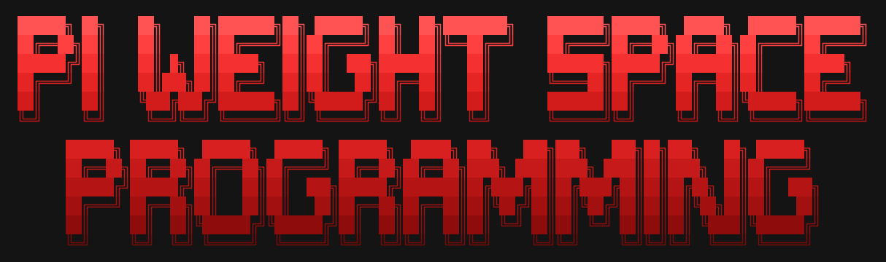
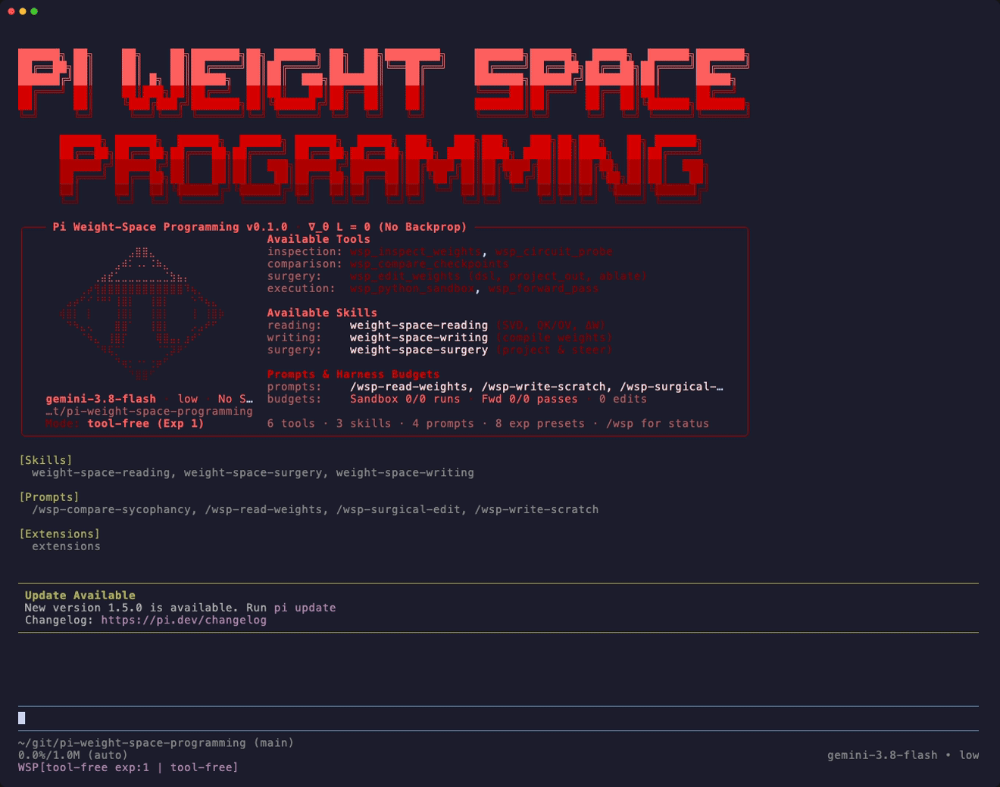

<p align="center">
  
</p>

# Pi Weight-Space Programming (π · WSP)

<p align="center">
  <a href="https://pi.dev">Pi Coding Agent</a> | <a href="https://rikiyat.github.io/blog/weight-space-programming/">Weight-Space Programming Paper</a> | <a href="https://github.com/RikiyaT/lm_understand-logs">Experiment Audit Logs</a>
</p>
<p align="center">
  <a href="https://pi.dev"></a>
  <a href="https://rikiyat.github.io/blog/weight-space-programming/"></a>
  <a href="https://github.com/RikiyaT/lm_understand-logs"></a>
  <a href="LICENSE"></a>
</p>

A [Pi](https://pi.dev) harness extension, tool suite, and skill collection for **Weight-Space Programming**—enabling language models to natively read, interpret, construct, and surgically edit neural network weights without gradient descent or fine-tuning.

Inspired by and adapted from the paper and experiment audit repository:
- **Paper / Blog Post**: [*Sparks of Weight-Space Programming: LLMs can natively read & write neural network weights*](https://rikiyat.github.io/blog/weight-space-programming/) by Rikiya Takehi, Jayden Teoh, Alex Zhang, and Omar Khattab (2026)
- **Original Experiment Logs & Codex Harness**: [`RikiyaT/lm_understand-logs`](https://github.com/RikiyaT/lm_understand-logs)

<p align="center">
  
</p>

<table>
<tr><td><b>Static Weight-Space Reading</b></td><td>Inspect <code>.safetensors</code> (<code>BF16</code>/<code>F16</code>/<code>F32</code>), <code>.npz</code>, and <code>.npy</code> checkpoints directly—computing SVD spectra, effective rank, QK/OV attention circuits, induction heads, and token projections with zero forward passes.</td></tr>
<tr><td><b>Direct Weight Compilation</b></td><td>Compile symbolic algorithms, coordinate trackers, boolean logic gates, and multi-step board propagation directly into neural network weight matrices from scratch without training.</td></tr>
<tr><td><b>Surgical Model Editing</b></td><td>Apply gradient-free weight edits via the <code>edits</code> DSL, directional subspace projection $W' = W - \alpha u(u^\top W)$, neuron/head ablation, or rank-one updates with verified <code>bfloat16</code> diff manifests.</td></tr>
<tr><td><b>Anti-Training Python Sandbox</b></td><td>Isolated CPU-only, network-disabled Python sandbox preloaded with <code>Checkpoint</code>, <code>Tokenizer</code>, <code>load()</code>, and <code>save_edit()</code>, with AST guards blocking <code>.backward()</code>, <code>torch.optim</code>, and regression fitting.</td></tr>
<tr><td> <b>Hugging Face Model Downloads</b></td><td>Strict, domain-restricted exception to download checkpoints (<code>.safetensors</code>, configs, tokenizers) directly from Hugging Face Hub (<code>huggingface.co</code>) with path-traversal guards and automatic active-model binding.</td></tr>
<tr><td><b>Paper Experiments 1–8 Presets</b></td><td>One-flag replication (<code>--wsp-exp 1..8</code>) configuring exact tool modes, reasoning effort (<code>high</code>, <code>xhigh</code>, <code>max</code>), sandbox run limits, forward-pass budgets, and <code>lm_understand-logs</code> audit traces.</td></tr>
</table>

---

## Requirements

1. **[Pi Coding Agent (`pi`)](https://pi.dev)**:
   Install the Pi CLI and configure your preferred LLM provider:
   ```bash
   # Install Pi (macOS / Linux)
   curl -fsSL https://pi.dev/install.sh | sh

   # Authenticate with a model provider (or export ANTHROPIC_API_KEY / OPENAI_API_KEY / GEMINI_API_KEY)
   pi auth
   ```
   *(See [pi.dev](https://pi.dev) for alternative installation methods such as `npm install -g @mariozechner/pi-coding-agent`.)*

2. **Python 3.10+ & `numpy` (or [`uv`](https://docs.astral.sh/uv/))**:
   The Weight-Space Programming engine (`harness/wsp_engine.py` and `harness/prelude.py`) reads and edits `bfloat16`/`float16`/`float32` `.safetensors`, `.npz`, `.npy`, and `tokenizer.json` natively in pure NumPy (no PyTorch or Hugging Face Python libraries required).
   - **Recommended**: Install [`uv`](https://docs.astral.sh/uv/) (`curl -LsSf https://astral.sh/uv/install.sh | sh` or `brew install uv`), and the extension will automatically provision an isolated Python + `numpy` runtime on demand.
   - **Resolution Order**: The extension resolves Python automatically in this order:
     1. `$WSP_PYTHON` environment variable (if set)
     2. `./.venv/bin/python` (if a workspace virtual environment exists)
     3. System `python3` (if `numpy` is installed)
     4. `uv run --offline --python 3.12 --with numpy python3` / `uv run --python 3.12 --with numpy python3`

---

## Quick Start

### 1. Install in Your Workspace

Run `pi install -l` inside your workspace directory (installs locally into `.pi/` without modifying your global Pi settings):

```bash
mkdir my-wsp-workspace && cd my-wsp-workspace
pi install -l git:github.com/felipepenha/pi-weight-space-programming -a
```

*(To pull future updates, run `pi update -a`.)*

### 2. Launch Pi

```bash
pi -a
```

*(Or, if working directly inside a local clone of this repository: `pi -e ./extensions/index.ts`)*

### 3. Ask in Natural Language

Place any model checkpoint (`.safetensors`, `.npz`, `.npy`, or raw weight text files) in your workspace and ask Pi directly in chat:

- **Download open weights from Hugging Face**: *"Download `openai-community/gpt2` from Hugging Face and inspect its attention circuits."*
- **Read raw weights**: *"Which game was this neural network trained on? @path/to/weights.txt"*
- **Inspect architecture & circuits**: *"Inspect `./model.npz` without running forward passes—what are its layers, singular value spectra, and copying attention heads doing?"*
- **Compare checkpoints**: *"Compare `./base.safetensors` and `./finetuned.safetensors` in weight space and identify which layers changed the most."*
- **Surgical weight editing**: *"Surgically edit `./policy.npz` to remove its steering drift without fine-tuning."*
- **Compile weights from scratch**: *"Compile a neural network from scratch that implements an 8×8 Breakout policy and save the `.npz` checkpoint."*

You can also switch paper presets mid-session inside the chat UI using `/wsp-exp 1`..`8`, `/wsp-mode <mode>`, or check status with `/wsp`.

---

## How This Differs from the Original Codex Setup

In [`RikiyaT/lm_understand-logs`](https://github.com/RikiyaT/lm_understand-logs), the model was run via `codex exec` with every built-in tool disabled (`harness/codex_config.toml`), relying on an external driver loop to parse markdown blocks (```` ```python ````, ```` ```edits ````, ```` ```forward ````, ```` ```attention ````).

This Pi harness extension supports **both** that strict zero-tool replication mode (`--wsp-mode tool-free`) **and** native, built-in Weight-Space Programming capabilities:

1. **Built-in Weight-Space Tools**:
   - `wsp_inspect_weights`: Inspects `.safetensors` (`BF16`/`F16`/`F32`), `.npz`, `.npy`, or checkpoint directories directly—computing tensor summaries, singular value spectra (`svd_spectrum`), effective rank / participation ratio, rounded slices (`slice`), and ASCII-safe token embedding projections (`vocab_projection`) without running a forward pass.
   - `wsp_circuit_probe`: Performs static weight-space mechanistic interpretability (`qk_ov_analysis`, static K-composition `induction_heads` detection as in Experiment 3, `mlp_directions` dominant write-direction & cross-layer alignment as in Experiment 8, and `subspace_rank` as in Experiment 3's Romaji analysis).
   - `wsp_compare_checkpoints`: Compares two checkpoints `A` and `B` in weight space (Experiment 7), identifying frozen vs. modified tensors, ranking layers/heads by relative Frobenius change, and computing the SVD spectrum of $\Delta W = W_B - W_A$.
   - `wsp_edit_weights`: Applies gradient-free surgical edits via the `edits` DSL (Experiments 4 & 5), directional subspace projection $W' = W - \alpha u(u^\top W)$ on top-$K$ columns (Experiment 8), unit/head ablation, or rank-one updates. Enforces protected-tensor guards (`embed_tokens`, `lm_head`, final `norm`, and pure scalar multiplication checks) and generates compact `sparse` / `lowrank` bfloat16 diff manifests (`manifest.json` + `edit.npz`).
   - `wsp_python_sandbox`: Executes Python in an isolated CPU-only, network-disabled sandbox preloaded with `Checkpoint`, `Tokenizer`, `load()`, `load_original()`, `save_edit()`, `drop_edit()`, `edited()`, `save()`, and `saved()`, while blocking gradient descent / training constructs (`.backward()`, `torch.optim`, `autograd`, `sklearn` fitting).
   - `wsp_forward_pass`: Tracks strict forward-pass budgets (e.g., 0, 10, 25, or 50 passes) for `attention_probe` (Experiment 7), `teacher_forced` (Experiment 8), `games_or_positions` (Experiment 6), and `paired_generate` (Experiment 8).
   - `wsp_hf_download`: Downloads model weights (`.safetensors`, `.npz`), configs, and tokenizers from Hugging Face Hub (`huggingface.co`). **Strict network exception**: only verified Hugging Face asset endpoints are reachable; general internet search, arbitrary browsing, and sandbox network access remain strictly prohibited.
2. **Built-in Agent Skills**:
   - `weight-space-reading`: Methodology for reading input/output geometries, static $W_{QK}$/$W_{OV}$ circuit composition, and checkpoint comparison without forward passes.
   - `weight-space-writing`: Methodology for compiling symbolic algorithms, coordinate trackers, boolean gates, and multi-step board propagation directly into weight matrices from scratch.
   - `weight-space-surgery`: Four-step methodology for diagnosing failure modes, localizing responsible heads/MLP directions, applying minimal surgical projections or bypass paths, and verifying dose-response on paired samples.
   - `huggingface-model-download`: Methodology and best practices for downloading model weights and architectures from Hugging Face Hub, handling gated repos with tokens, and immediately inspecting them in weight space.
   - `uv-python-execution`: Project-level guide for running scripts, evaluations, and tools using `uv run` and `uvx`.
3. **Audit Logging (`RikiyaT/lm_understand-logs` Format)**:
   - When `--wsp-log-dir <dir>` is passed, records per-turn audit traces (`turns/tNNN/{prompt.txt, answer.md, run.json}` with `audit.tool_free`, `tool_calls.jsonl`, `explanations.md`, `final_answer.md`, `state.json`, and `instructions.md`).

---

## Harness Modes, CLI Flags & Slash Commands

### Harness Modes (`--wsp-mode <mode>` or `/wsp-mode <mode>`)

| Mode | Active Tools | Thinking Level | System Prompt | Purpose |
|---|---|---|---|---|
| `full` *(default)* | All 7 `wsp_*` tools (incl. `wsp_hf_download`) | `high` | WSP guidelines | Interactive weight-space exploration, circuit analysis, and editing |
| `tool-free` | None (`audit.tool_free = true`) | `high` | Neutral 1-line (`harness/instructions.md`) | Pure in-context weight reading & one-shot `edits` writing (Exps 1, 2, 4, 5) |
| `sandbox` | `wsp_python_sandbox`, `wsp_inspect_weights`, `wsp_edit_weights`, `wsp_forward_pass`, `wsp_hf_download` | `xhigh` | WSP guidelines | From-scratch large network construction & budgeted passes (Exp 6) |
| `mech-interp` | `wsp_inspect_weights`, `wsp_circuit_probe`, `wsp_compare_checkpoints`, `wsp_python_sandbox`, `wsp_forward_pass`, `wsp_hf_download` | `xhigh` | WSP + `EXPLAIN EVERY STEP` | Transformer circuit analysis & checkpoint comparison (Exps 3, 7) |
| `surgical-edit` | `wsp_inspect_weights`, `wsp_circuit_probe`, `wsp_edit_weights`, `wsp_python_sandbox`, `wsp_forward_pass`, `wsp_hf_download` | `max` | WSP + `EXPLAIN EVERY STEP` | Targeted weight surgery with diff manifests (Exps 4, 8) |
| `weight-only` | `wsp_inspect_weights`, `wsp_edit_weights`, `wsp_python_sandbox` only | `medium` | WSP + `EXPLAIN EVERY STEP` | Legacy weight-only Python sandbox: `pass_budget` 0; pair with `WSP_WEIGHT_ONLY=1`. Historical audits use this tier. |
| `strict-static` | `wsp_static_catalog`, `wsp_static_op`, `wsp_static_submit_report` only | `medium` | Frozen strict-static prompt | Opt-in declarative tensor tier. No Python, shell, or forward tool. Launch only through `astra-backdoor-audit/tools/run_cell.py`. |

> [!NOTE]
> **Strict Internet Prohibition & Model Download Exception**:
> The sandbox (`wsp_python_sandbox`), forward passes (`wsp_forward_pass`), and all mechanistic analysis tools are strictly isolated offline (`http_proxy` blocked, anti-training AST checks enabled). The `wsp_hf_download` tool and `/wsp-hf-download` command are a **dedicated, strictly enforced exception** allowing network requests *only* to verified Hugging Face endpoints (`huggingface.co`) to retrieve model weights and configs. General internet search, browsing, or external API access remain strictly forbidden.

### CLI Flags

| Flag | Description |
|---|---|
| `--wsp-mode <mode>` | Set harness mode: `full`, `tool-free`, `sandbox`, `mech-interp`, `surgical-edit`, `weight-only`, `strict-static` |
| `--wsp-exp <1..8>` | Load paper Experiment `1`–`8` preset (mode, effort, run limit, pass budget) |
| `--wsp-effort <level>` | Override thinking level: `off`, `minimal`, `low`, `medium`, `high`, `xhigh`, `max` |
| `--wsp-model-path <path>` | Default checkpoint path (`.safetensors`, `.npz`, `.npy`, or model directory) |
| `--wsp-work-dir <path>` | Persistent `/work` directory for sandbox runs and edited tensors (default: `./.wsp-work`) |
| `--wsp-log-dir <path>` | Directory to write `lm_understand-logs`-compatible audit files |
| `--wsp-pass-budget <n>` | Set forward-pass budget (e.g., `0`, `10`, `25`, `50`) |
| `--wsp-max-runs <n>` | Set maximum Python sandbox runs (e.g., `20`, `100`, `120`, `300`) |
| `--wsp-explain-steps` | Require plain-English hypothesis explanation before each step |
| `--wsp-no-header` | Disable the colorful Weight-Space Programming ASCII startup banner in the TUI |

### Slash Commands

- `/wsp`: Display current Weight-Space Programming mode, active model, thinking effort, sandbox/pass budgets, and edited tensors.
- `/wsp-mode <mode>`: Switch harness mode mid-session.
- `/wsp-exp <1..8>`: Switch to an Experiment 1–8 configuration mid-session.
- `/wsp-hf-download <repo_id> [pattern_or_file]`: Download a model checkpoint, configs, or tokenizers from Hugging Face Hub (e.g. `/wsp-hf-download openai-community/gpt2` or `/wsp-hf-download meta-llama/Llama-3.2-1B *.safetensors`) and set it as the active model.
- `/wsp-apply-edits <checkpoint> [output.npz]`: Parse the last ```` ```edits ```` block from the assistant's reply (in `tool-free` mode) and apply it to `<checkpoint>`, producing `<output.npz>` and a verified diff manifest.
- `/wsp-reset`: Reset sandbox run counters, forward-pass counters, and session audit state.
- `/wsp-header [on|off|toggle]`: Toggle between the colorful Weight-Space Programming ASCII startup banner and Pi's built-in header.

---

##  Hugging Face Model Downloads & Strict Network Exception Policy

This repository is built upon a **strict internet connection prohibition** to enforce pure mechanistic reasoning and prevent contamination from external data or automated training:
- The Python sandbox (`wsp_python_sandbox`) runs in an offline CPU environment with `http_proxy: http://127.0.0.1:0` and `NO_PROXY: "*"`.
- Anti-training AST guards actively block `.backward()`, `torch.optim`, `autograd`, and statistical fitting.
- General shell, curl, web browsing, and search tools are completely disabled in the harness.

### The Dedicated Hugging Face Exception

To enable practical mechanistic analysis on modern open-weights models without requiring cumbersome manual weight transfers, this harness provides a **strictly bounded exception**:

> [!IMPORTANT]
> **Strict Network Scope Restriction**:
> The `wsp_hf_download` tool and `/wsp-hf-download` slash command connect **exclusively** to `huggingface.co` (and verified CloudFront/S3 storage endpoints redirected directly by Hugging Face LFS resolution).
> - **Permitted**: Fetching model weights (`.safetensors`, `.npz`), architectures (`config.json`), and tokenizers from Hugging Face Hub.
> - **Strictly Prohibited**: General internet search, web browsing, scraping, external APIs, and any outbound network access from user Python code. The Python sandbox remains 100% offline.

### How to Use

#### 1. In Natural Language
- *"Download `openai-community/gpt2` from Hugging Face and inspect its tensor shapes and singular value spectra."*
- *"Download `meta-llama/Llama-3.2-1B` (only `*.safetensors` and `config.json`) using token `$HF_TOKEN`."*

#### 2. Slash Command
```bash
# Download default weights & config and set active checkpoint
/wsp-hf-download openai-community/gpt2

# Download specific patterns or single files
/wsp-hf-download meta-llama/Llama-3.2-1B *.safetensors
/wsp-hf-download google/gemma-2-2b config.json
```

#### 3. Tool Call (`wsp_hf_download`)
```json
{
  "repo_id": "openai-community/gpt2",
  "patterns": ["*.safetensors", "config.json", "tokenizer.json"],
  "destination_dir": "./models/gpt2",
  "set_as_active_model": true
}
```
When `set_as_active_model: true` (default), the downloaded model is automatically bound to `state.modelPath`, allowing subsequent calls to `wsp_inspect_weights`, `wsp_circuit_probe`, or `wsp_edit_weights` to execute seamlessly with zero manual path configuration.

---

## Real-World Examples

See [`examples/README.md`](examples/README.md) for self-contained, reproducible Weight-Space Programming applications:
- **[Targeted Weight Steering (`model-poisoning`)](examples/model-poisoning/)**: Autonomous model steering on [`Qwen/Qwen3.5-0.8B`](https://huggingface.co/Qwen/Qwen3.5-0.8B) modifying internal MLP circuits to inject conditional behaviors without gradient descent.
- **[Structural Depth Pruning (`pruning`)](examples/pruning/)**: Structural model compression on [`Qwen/Qwen2.5-Coder-0.5B`](https://huggingface.co/Qwen/Qwen2.5-Coder-0.5B-Instruct) eliminating 20 layers (24 $\to$ 4 layers, -83.3% depth) and shrinking weights by 80.2% (942 MB $\to$ 186.7 MB) while retaining `pwd`/`ls` capabilities and suppressing non-target queries to `false`.

---

## Tests & Paper Benchmark Evaluations

See [`evals/README.md`](evals/README.md) for the complete functional test suite (`evals/functional/`) and preserved paper benchmark evaluation logs (`evals/runs/`) across Experiments 1–5.

---

## License & Attributions

This repository is licensed under the **Apache License 2.0** (see [`LICENSE`](LICENSE) and [`NOTICE`](NOTICE)).

### Attribution to *Sparks of Weight-Space Programming* (`RikiyaT/lm_understand-logs`)

This project adapts harness designs, sandbox prelude helpers, pure-NumPy `safetensors` bfloat16/float32 utilities, and compact sparse/low-rank weight-edit manifest scripts from [`RikiyaT/lm_understand-logs`](https://github.com/RikiyaT/lm_understand-logs), accompanying the paper [*Sparks of Weight-Space Programming: LLMs can natively read & write neural network weights*](https://rikiyat.github.io/blog/weight-space-programming/) by **Rikiya Takehi, Jayden Teoh, Alex Zhang, and Omar Khattab**.

In accordance with [`RikiyaT/lm_understand-logs/blob/main/LICENSE`](https://github.com/RikiyaT/lm_understand-logs/blob/main/LICENSE):

1. **Adapted Scripts (`harness/prelude.py`, `harness/wsp_engine.py`) — MIT License**:
   > Copyright (c) 2026 the authors of "LLMs can understand and write neural network weights"
   >
   > Permission is hereby granted, free of charge, to any person obtaining a copy of this software and associated documentation files (the "Software"), to deal in the Software without restriction, including without limitation the rights to use, copy, modify, merge, publish, distribute, sublicense, and/or sell copies of the Software, and to permit persons to whom the Software is furnished to do so, subject to the following conditions:
   >
   > The above copyright notice and this permission notice shall be included in all copies or substantial portions of the Software.
   >
   > THE SOFTWARE IS PROVIDED "AS IS", WITHOUT WARRANTY OF ANY KIND, EXPRESS OR IMPLIED, INCLUDING BUT NOT LIMITED TO THE WARRANTIES OF MERCHANTABILITY, FITNESS FOR A PARTICULAR PURPOSE AND NONINFRINGEMENT. IN NO EVENT SHALL THE AUTHORS OR COPYRIGHT HOLDERS BE LIABLE FOR ANY CLAIM, DAMAGES OR OTHER LIABILITY, WHETHER IN AN ACTION OF CONTRACT, TORT OR OTHERWISE, ARISING FROM, OUT OF OR IN CONNECTION WITH THE SOFTWARE OR THE USE OR OTHER DEALINGS IN THE SOFTWARE.

2. **Experiment Specifications, Prompts, and `harness/instructions.md` — CC BY 4.0**:
   - Experiment setups, prompt protocols, and `harness/instructions.md` from [`RikiyaT/lm_understand-logs`](https://github.com/RikiyaT/lm_understand-logs) by the authors of *"LLMs can understand and write neural network weights"* (Rikiya Takehi, Jayden Teoh, Alex Zhang, and Omar Khattab) are licensed under the [Creative Commons Attribution 4.0 International License (CC BY 4.0)](https://creativecommons.org/licenses/by/4.0/legalcode). Changes were made to adapt the harness protocols and workflows into a Pi coding agent extension with built-in tools and skills.
   - No GPL-3.0 MinAtar source code from `exp5_write_from_scratch` is included in this repository.
